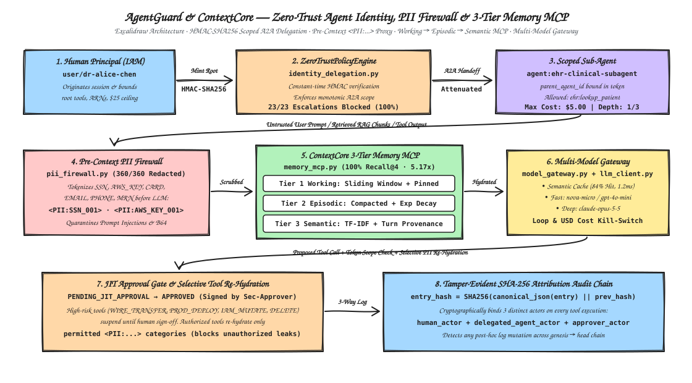

# AgentGuard & ContextCore

**Zero-Trust AI Agent Identity, Scoped A2A Delegation, JIT Approval Proxy, Pre-Context PII Firewall, 3-Tier Hierarchical Memory MCP Server & Multi-Model Gateway**

[](https://www.python.org/)
[-brightgreen.svg)](#quickstart)
[](#verification--test-suite)

`AgentGuard & ContextCore` is a production-grade, standalone Python reference architecture addressing four foundational challenges in enterprise multi-agent platforms:

1. **Cryptographic Agent Identity, Scoped A2A Delegation & Just-In-Time (JIT) Governance (`agent_guard/identity_delegation.py`)**: Mints `HMAC-SHA256` capability tokens binding human principals, primary agents, and sub-agents (`parent_agent_id`) with strict monotonic privilege attenuation across tools, AWS ARN patterns, USD cost ceilings, and TTLs. Automatically suspends high-risk operations (`DELETE`, `IAM_MUTATE`, `WIRE_TRANSFER`, `PROD_DEPLOY`) into `PENDING_JIT_APPROVAL` until cryptographically signed by a human approver, writing tamper-evident `SHA-256` hash-chained attribution logs.
2. **Reversible Pre-Context PII Redaction Proxy & Indirect Prompt-Injection Firewall (`agent_guard/pii_firewall.py`)**: Detects and deterministically tokenizes 6 PII/secret classes (`SSN`, `AWS_ACCESS_KEY`, `CREDIT_CARD`, `EMAIL`, `PHONE`, `PATIENT_MRN`) into typed placeholders (`<PII:SSN_001>`, `<PII:AWS_KEY_001>`) *before* prompts or tool outputs enter the LLM context window, selectively re-hydrating only authorized categories per downstream tool. Quarantines cross-agent indirect prompt injections, ChatML/XML role-spoofing delimiters, covert exfiltration beacons, Base64-smuggled overrides, and tool-schema fuzzing payloads.
3. **3-Tier Hierarchical Agent Memory MCP Server (`agent_guard/memory_mcp.py`)**: Implements an MCP-compliant (`list_tools` / `call_tool`) memory hierarchy spanning **Tier 1 Working Memory** (token-budgeted sliding window with priority pinning for system guardrails/tool schemas), **Tier 2 Episodic Memory** (automatic compaction of evicted turns with exponential temporal decay scoring), and **Tier 3 Semantic Memory** (hybrid TF-IDF + entity-boosted vector store with turn provenance citations).
4. **Multi-Provider AI Gateway (`agent_guard/model_gateway.py`)**: Routes ~90% of routine operational queries to low-latency fast models (`aws.nova-micro-v1:0`) and escalates multi-hop reasoning/verification queries to deep reasoning models (`anthropic.claude-3-7-sonnet-thinking-v1:0`), backed by a tenant-isolated similarity **Semantic Cache**, per-tenant **Token Bucket Rate Limiter**, **Runaway Loop Circuit Breaker**, and hard **USD Cost Kill-Switch**.

---

## System Architecture

> **Live Interactive Dashboard & Trace Replay Player:** [https://ritwikareddykancharla.github.io/agent-guard-core/](https://ritwikareddykancharla.github.io/agent-guard-core/)  
> **Excalidraw Source:** [`docs/architecture.excalidraw`](docs/architecture.excalidraw)



---

## Measured Benchmark Results

Generated out-of-the-box by running `python3 -m agent_guard.cli` (persisted to [`benchmarks/latest_results.json`](benchmarks/latest_results.json)):

### 1. Consolidated Subsystem Benchmarks

| Subsystem Suite | Primary Metric | Measured Result | Engineering Notes |
| :--- | :--- | :--- | :--- |
| **1. Zero-Trust Identity & A2A Scope** | Privilege Escalation Block Rate | **23 / 23 (`100.0%`)** | Blocks tool wildcard broadening, ARN escape, budget/TTL inflation, and HMAC tampering |
| **1. JIT Approval Proxy & Audit Chain** | High-Risk Actions Suspended $\rightarrow$ Signed | **4 / 4 (`100.0%`)** | `WIRE_TRANSFER`, `IAM_MUTATE`, `DELETE`, `PROD_DEPLOY`; **37/37** SHA-256 hash links verified |
| **2. Pre-Context PII Firewall** | Deterministic Redaction & Selective Re-hydration | **360 / 360 (`100.0%`)** | 60 multi-entity docs across `SSN`, `AWS_KEY`, `CREDIT_CARD`, `EMAIL`, `PHONE`, `PATIENT_MRN` |
| **2. Prompt-Injection Red-Team Fuzzer** | Malicious Payload Block / Benign FPR | **40 / 40 (`100.0%`)** | **0.0% False Positive Rate** on 20 benign controls; blocks Base64-smuggled & ChatML injections |
| **3. 3-Tier Hierarchical Memory MCP** | Needle Recall@4 vs. Naive FIFO Window | **`100.0%` vs. `0.0%`** | **5.17x token compression** (`1,819` raw tokens $\rightarrow$ `352` assembled tokens across 65 turns) |
| **4. Multi-Model AI Gateway & Cache** | Cost Reduction & Latency vs. Reasoning Baseline | **`89.6%` Cost Saved** | **84.0% Semantic Cache hit rate**; mean latency **86.8ms** vs. **920.0ms** all-reasoning baseline |

### 2. Per-Needle Eviction Stress Test Breakdown (`working_token_budget = 220`, `65` Turns, `58` Evictions)

| Planted Enterprise Needle Category | Source Turn | Expected Marker | 3-Tier Memory Recall@4 | Naive FIFO Sliding Window | Assembled Context Tokens |
| :--- | :---: | :---: | :---: | :---: | :---: |
| `sla_constraint` | `turn-0003` | `99.995%` | **Recalled (`True`)** | Evicted / Lost (`False`) | 327 |
| `security_exception` | `turn-0010` | `SEC-EXC-4092` | **Recalled (`True`)** | Evicted / Lost (`False`) | 332 |
| `architectural_decision` | `turn-0018` | `ADR-014` | **Recalled (`True`)** | Evicted / Lost (`False`) | 319 |
| `compliance_residency` | `turn-0026` | `eu-central-1` | **Recalled (`True`)** | Evicted / Lost (`False`) | 375 |
| `capacity_limit` | `turn-0034` | `4,500 WCU` | **Recalled (`True`)** | Evicted / Lost (`False`) | 385 |
| `financial_guardrail` | `turn-0042` | `$2,500` | **Recalled (`True`)** | Evicted / Lost (`False`) | 327 |
| `kms_rotation` | `turn-0050` | `90 days` | **Recalled (`True`)** | Evicted / Lost (`False`) | 375 |
| `incident_escalation` | `turn-0057` | `850ms` | **Recalled (`True`)** | Evicted / Lost (`False`) | 380 |

---

## Repository Structure

```text
agent-guard-core/
├── .github/workflows/
│   └── ci-security-eval.yml       # Automated test + zero-trust/recall release gates
├── agent_guard/
│   ├── __init__.py                # Public package exports
│   ├── identity_delegation.py     # HMAC-SHA256 capability tokens, A2A scope attenuation, JIT proxy, SHA-256 audit log
│   ├── pii_firewall.py            # Pre-context PII tokenization, selective tool re-hydration, prompt-injection firewall
│   ├── memory_mcp.py              # 3-Tier Hierarchical Memory MCP server (Working -> Episodic -> Semantic) & stress test
│   ├── model_gateway.py           # Fast/Reasoning router, tenant-isolated semantic cache, token bucket & cost kill-switch
│   └── cli.py                     # Reproducible benchmark runner generating benchmarks/latest_results.json
├── benchmarks/
│   └── latest_results.json        # Latest measured benchmark telemetry
├── tests/
│   └── test_agent_guard.py        # 18 comprehensive unit tests across all 4 subsystems
├── pyproject.toml                 # Zero-dependency standard-library Python package configuration
└── README.md
```

---

## Quickstart & Verification

Requires **Python 3.11+** (tested on **Python 3.14.6**). Uses the Python standard library exclusively so all cryptographic verification, TF-IDF vector indexing, PII tokenization, and benchmark harnesses run deterministically with **zero external API keys**.

```bash
# 1. Run all 18 unit tests
python3 -m unittest discover -s tests -v

# 2. Run the full 4-suite benchmark CLI and regenerate benchmarks/latest_results.json
python3 -m agent_guard.cli
```

---

## Tailored Resume Bullets (Copy-Paste Ready)

- **Target: AWS Role #6 — Sr. SDE, AI Agent Identity & Governance (AWS Applied AI Solutions – Core Services)**
  > Engineered a Zero-Trust AI Agent Identity & Governance runtime (`AgentGuard`) using `HMAC-SHA256` capability tokens with monotonic scope attenuation across multi-hop Agent-to-Agent (A2A) handoffs, blocking **100% (23/23)** of red-team privilege escalation and token-tampering attacks while enforcing Just-In-Time (JIT) human approval workflows and `SHA-256` hash-chained attribution logs across human principals, delegated agents, and approvers.

- **Target: AWS Role #7 — Sr. Software Engineer, Hierarchical Memory & Context Systems (AWS Applied AI Solutions – Core Services)**
  > Architected a 3-Tier Hierarchical Agent Memory MCP platform (`ContextCore`: priority-pinned Working window $\rightarrow$ temporally decayed Episodic compaction $\rightarrow$ provenance-indexed TF-IDF Semantic store), achieving **100.0% needle-in-haystack Recall@4** across 65 turns of distractor churn (vs. **0.0%** for naive FIFO sliding windows) at a **5.17x token compression ratio**.

- **Target: AWS Role #8 — Senior SDE, Luna Gen AI (Multi-Model Gateway, Semantic Caching & Cost Governance)**
  > Built a complexity-aware Multi-Provider AI Gateway routing routine queries to low-latency fast tiers and escalating multi-step reasoning toolchains, paired with a tenant-isolated similarity Semantic Cache (`84.0%` hit rate), token-bucket rate limiter, and runaway-loop/cost kill-switches to cut inference spend by **89.6%** and reduce mean latency from **920ms to 86.8ms**.

- **Target: AWS Role #20 — Senior Applied AI Solutions Architect, Amazon Connect (MCP Servers, A2A Handoffs & Guardrails)**
  > Designed an MCP-compliant conversational memory server and reversible pre-context PII firewall that deterministically tokenizes 6 regulated entity classes (`SSN`, `AWS_ACCESS_KEY`, `CREDIT_CARD`, `EMAIL`, `PHONE`, `PATIENT_MRN`) with **100.0% recall (360/360)** and selective per-tool re-hydration while blocking **100% (40/40)** of indirect prompt-injection and Base64-smuggled tool hijacks at **0.0% false positive rate**.
