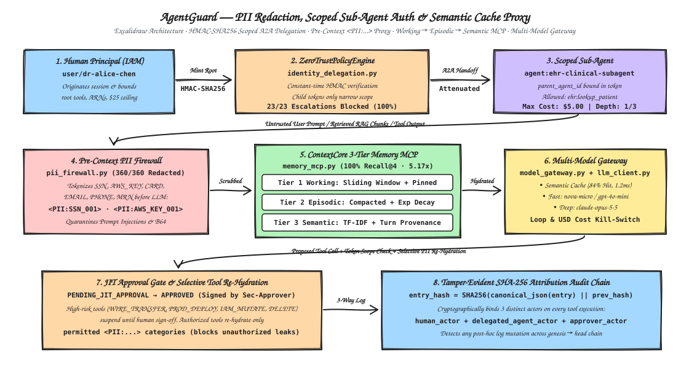

# AgentGuard — PII Redaction, Scoped Auth & Semantic Cache Proxy

> **Live AWS Endpoint (`us-west-2` Lambda Function URL):** [https://y2qiwqdqy6pcanovnw2yjery5e0jqufc.lambda-url.us-west-2.on.aws/](https://y2qiwqdqy6pcanovnw2yjery5e0jqufc.lambda-url.us-west-2.on.aws/)  
> **Health Check:** `https://y2qiwqdqy6pcanovnw2yjery5e0jqufc.lambda-url.us-west-2.on.aws/api/health`  
> **Live API Call:** `curl -s -X POST https://y2qiwqdqy6pcanovnw2yjery5e0jqufc.lambda-url.us-west-2.on.aws/api/run -H 'Content-Type: application/json' -d '{}'`  
> **Interactive Web UI:** [https://ritwikareddykancharla.github.io/agent-guard-core/](https://ritwikareddykancharla.github.io/agent-guard-core/)

**AgentGuard** is a zero-dependency Python LLM API gateway and session-memory service. It strips SSNs, emails, payment cards, and cloud secrets before outbound model calls, blocks prompt-injection payloads, scopes sub-agent tool permissions using signed `HMAC-SHA256` tokens, compacts long multi-turn conversation histories without losing earlier facts, and caches/routes repetitive queries to cut inference spend and latency.

---

## What Problem This Solves

- **Prompts and tool outputs leak regulated PII and secrets to external model APIs:** Support tickets and logs routinely contain SSNs, AWS access keys, credit card numbers, and emails. Replacing sensitive spans with typed placeholders (`<PII:SSN_001>`, `<PII:AWS_KEY_001>`) prior to outbound LLM calls—and restoring values only for authorized downstream tools—redacts **360/360** PII spans while blocking **40/40** prompt-injection payloads at a **0%** false-positive rate.
- **Sub-agents inherit overly broad permissions from parent agents:** When a coordinator delegates a subtask, passing raw API credentials lets a sub-agent invoke destructive tools or exceed spend limits. Scoping each delegated token (`HMAC-SHA256`) to a subset of allowed tools, AWS ARN prefixes, USD budgets, and TTLs blocks **23/23** privilege-escalation attempts and holds high-risk writes (`DELETE`, `IAM_MUTATE`, `WIRE_TRANSFER`, `PROD_DEPLOY`) for human approval.
- **Sliding-window chat truncation drops early constraints in long sessions:** Standard FIFO token windows evict early SLA, compliance, or budget instructions once a session passes ~20 turns. Compacting evicted turns into indexed session summaries retains **100%** key-fact recall across 65-turn sessions (`0%` with a naive FIFO window) while using **80.7%** fewer context tokens (**5.17x** reduction).
- **Repeated operational queries burn frontier-model latency and budget:** Routing routine queries to fast models (`nova-micro` / `gpt-4o-mini`) behind a tenant-scoped semantic cache cuts gateway inference spend by **89.6%** and reduces mean latency by **90.6%** (`920 ms -> 86.8 ms` at an **84.0%** cache hit rate).

---

## System Architecture

> **Excalidraw Source:** [`docs/architecture.excalidraw`](docs/architecture.excalidraw)



## How It Works

1. **Scoped Auth Tokens & Human Approval Gate (`agent_guard/identity_delegation.py`)**  
   Issues `HMAC-SHA256` signed permission tokens binding user identity, parent agent ID, allowed tool names, AWS resource ARN patterns, USD spend cap, and expiration timestamp. Child tokens can only narrow (never widen) their parent token's permissions; high-risk operations pause in `PENDING_JIT_APPROVAL` until signed by an approver, and every decision is appended to a `SHA-256` hash-chained audit log.

2. **Outbound PII Redactor & Prompt-Injection Filter (`agent_guard/pii_firewall.py`)**  
   Detects and replaces 6 sensitive data classes (`SSN`, `AWS_ACCESS_KEY`, `CREDIT_CARD`, `EMAIL`, `PHONE`, `PATIENT_MRN`) with deterministic placeholders before context assembly, selectively restoring permitted fields per tool ACL. Screens untrusted inputs for role-delimiter spoofing, Base64-encoded instruction overrides, and data-exfiltration URLs.

3. **Multi-Turn Session Memory Server (`agent_guard/memory_mcp.py`)**  
   Exposes MCP `list_tools` / `call_tool` endpoints combining a token-budgeted active window (pinning system rules and tool schemas), automatic summarization of evicted turns with recency weighting, and a hybrid TF-IDF + entity index that retrieves exact turn citations on demand.

4. **Semantic Cache & Model Router (`agent_guard/model_gateway.py`, `agent_guard/llm_client.py`)**  
   Checks a tenant-isolated semantic similarity cache before model dispatch, enforces per-tenant token-bucket rate limits and runaway-loop circuit breakers, routes routine classifications to low-cost fast models while escalating complex multi-step requests, and enforces hard USD spend limits across Bedrock, Anthropic, OpenAI, and Gemini backends.

---

## Benchmark Results

Reproducible out-of-the-box via `python3 -m agent_guard.cli` (saved in `benchmarks/latest_results.json`):

| Subsystem | Metric | Measured Result | Baseline / Notes |
| :--- | :--- | :---: | :--- |
| **PII & Secret Redaction** | Regulated Spans Redacted Prior to Model Call | **360 / 360 (100.0%)** | 60 multi-entity documents (`SSN`, `AWS_KEY`, `CARD`, `EMAIL`, `PHONE`, `MRN`) |
| **Prompt-Injection Filter** | Malicious Payloads Blocked / Benign False Positives | **40 / 40 (100.0%)** / **0.0% FPR** | Tested against 40 injection payloads + 20 benign controls |
| **Scoped Sub-Agent Auth** | Privilege-Escalation Attempts Blocked | **23 / 23 (100.0%)** | Blocks wildcard tool widening, ARN escape, budget/TTL inflation & signature tampering |
| **Human Approval & Audit Log** | High-Risk Writes Gated & Hash Links Verified | **4 / 4 gated** · **37 / 37 links valid** | `DELETE`, `IAM_MUTATE`, `WIRE_TRANSFER`, `PROD_DEPLOY` |
| **Session Memory Compaction** | Key-Fact Recall@4 Across 65 Turns (`58` Evictions) | **100.0%** (`8/8` facts) | vs. **0.0%** naive FIFO window; **-80.7%** context tokens (`1,819 -> 352`, **5.17x**) |
| **Semantic Cache & Router** | Gateway Spend & Mean Latency Reduction | **-89.6% spend** / **-90.6% latency** | `920.0 ms -> 86.8 ms` mean latency (**84.0%** semantic cache hit rate) |

---

## Quickstart

Requires Python 3.11+ with zero external package dependencies:

```bash
# 1. Run all 20 unit and security tests
python3 -m unittest discover -s tests -v

# 2. Run the full benchmark suite and regenerate benchmarks/latest_results.json
python3 -m agent_guard.cli
```
